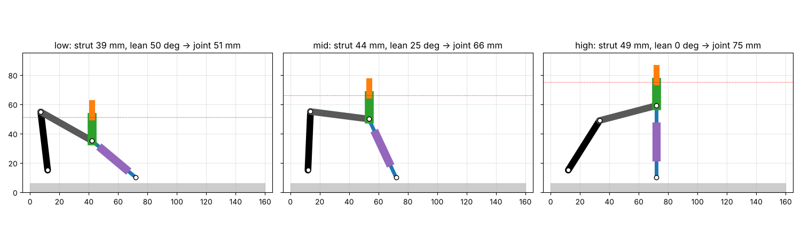
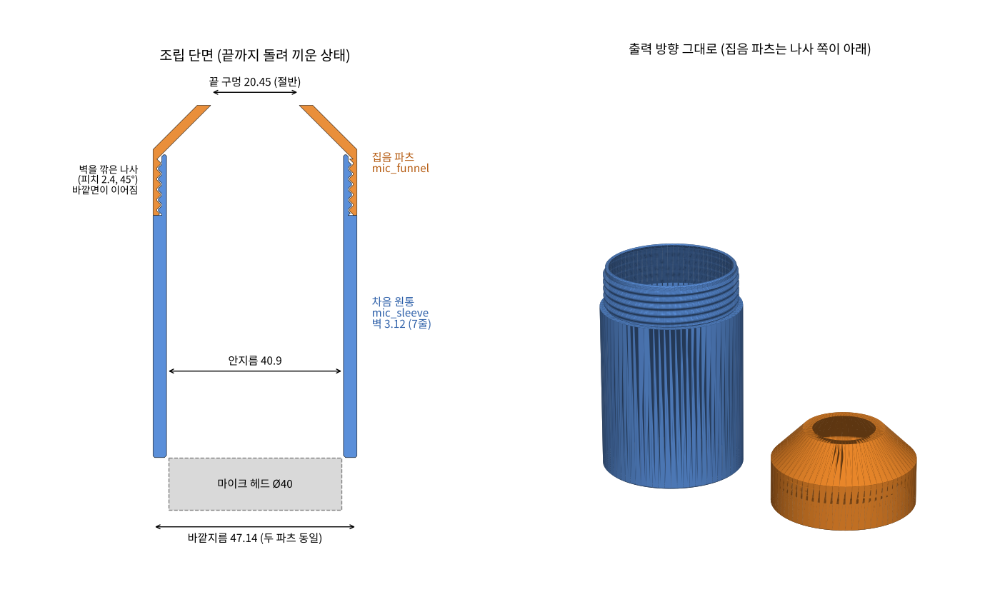
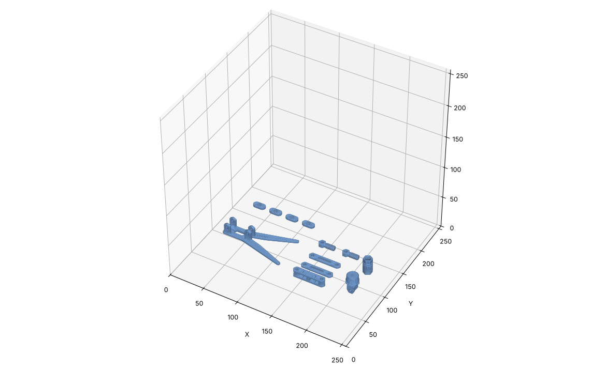
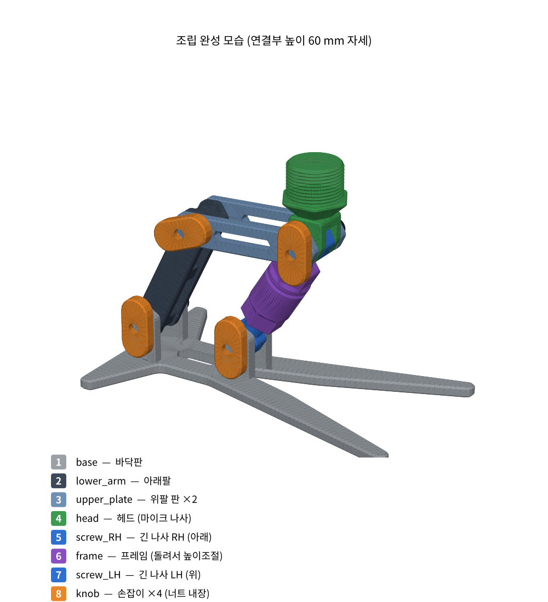
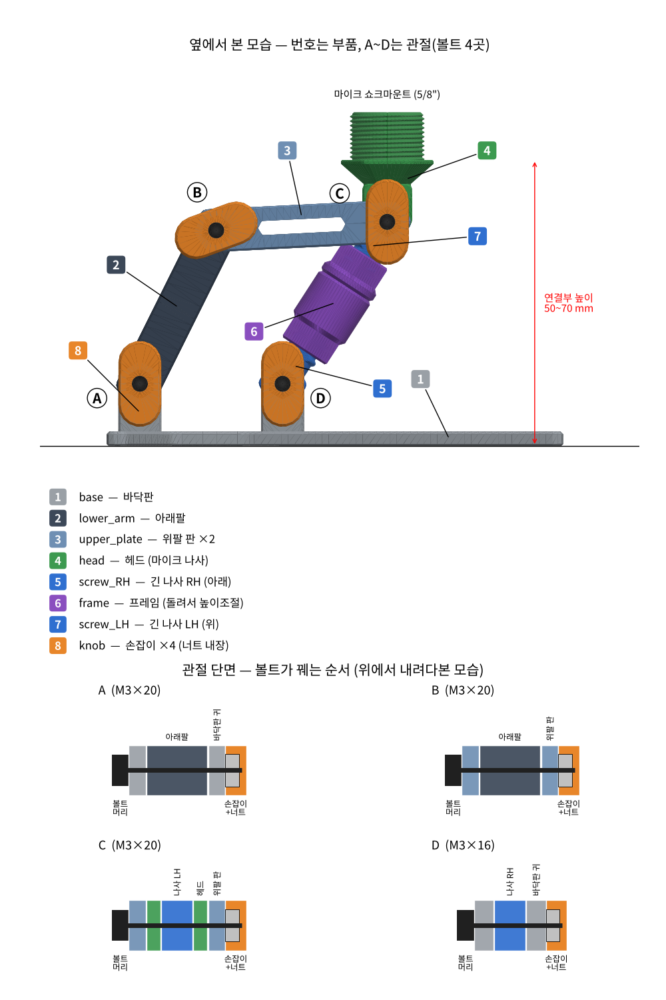

# Fifine K688 마이크 스탠드 제작
> Fifine K688 마이크를 책상 위에 낮게 세워 둘 수 있는 다관절·높이조절 탁상 스탠드 제작

* 상태: `v5 출력 준비 완료` (출력 설정이 들어간 Bambu Studio 프로젝트 3MF, 시험 출력 전)

## 사용 하드웨어
| 종류 | 명칭 |
| :---: | :--- |
| 3d 프린터 | Bambulab A1 |
| 필라멘트 | Bambu PLA Basic (3MF 기본값, 다른 PLA로 바꿔도 됨) |
| 철물 | M3×20 볼트 3개, M3×16 볼트 1개, M3 너트 4개 |
| 공구 | 버니어 캘리퍼스(권장), 드라이버 |

## 사용 소프트웨어
| 종류 | 명칭 |
| :---: | :--- |
| 슬라이서 | Bambu Studio |
| 모델링 툴 | Python 스크립트 (`models/k688_mic_stand/generate.py`) |

## 요구사항
* 마이크 연결부(나사산 시작점)는 바닥으로부터 **5~7cm** 높이에 위치한다.
* 바닥판은 **V자**이고 차지하는 공간이 작아야 한다. (v2 대비 25% 이하)
* 높이를 바꿀 때 **마이크를 돌리지 않아야** 한다.
* **앞뒤 위치**도 조절할 수 있도록 관절을 여러 개로 나눈다.
* 높이조절부는 **양 끝에 너트가 달린 속 빈 프레임 + 긴 나사** 구조이며 전부 출력 부품이다.
* 관절은 M3 볼트와 너트를 강하게 조여 고정한다. 볼트는 **12 / 16 / 20 / 25 mm** 중에서 쓴다.
* 하중은 600 g 미만이다. 부재를 필요 이상으로 두껍게 만들지 않는다.
* 손으로 돌리는 부분에 꽃모양(물결 홈)을 쓰지 않는다. 손잡이는 끝이 둥근 1자 형상.
* 모서리는 약간 깎아 부드럽게 한다.
* 둥근 관절부는 **모서리가 둥근 육각형**으로 디자인한다.
* 3MF에 **떼어내기 쉬운 서포트와 안정적인 출력 설정**을 넣는다.
* 마이크 헤드(Ø40)에 끼워 주변 소리를 막는 **차음 원통**(벽 5줄)과, 그 끝 나사에 돌려 끼우는 **집음 파츠**를 함께 만든다.

## 규격 조사

### 마이크 본체
| 항목 | 값 | 비고 |
| :---: | :--- | :--- |
| 길이 | 약 190 mm | 후면 노브 포함, 리뷰어 실측 |
| 본체 지름 | 약 55 mm | 쇼크마운트 제외 |
| 쇼크마운트 포함 지름 | 약 105 mm | |
| 마운트 암 돌출 | 약 45 mm | 스위블 포함 |
| 무게 | 331 g (실측) / 510 g (판매처 표기) | 출처 간 불일치 |
| 재질 | 금속 바디 | |

* 치수는 공식 도면이 아니라 리뷰어 실측값이다. 출력 전에 캘리퍼스로 다시 잰다.
* 쇼크마운트는 탄성 밴드 방식이며 마이크에 장착된 상태로 온다. 스탠드는 쇼크마운트의 나사에 체결한다.

### 마운트 나사
* 쇼크마운트 쪽은 **5/8"-27 암나사**이다. → 헤드에 **5/8"-27 수나사**가 필요하다.
* 동봉된 어댑터(5/8" 수 → 3/8" 암)를 끼우면 3/8"-16 수나사에도 올릴 수 있다.

| 나사 | 외경 | 피치 | 암나사 하혈(내경) | 나사산 각도 |
| :---: | :--- | :--- | :--- | :---: |
| 5/8"-27 UNS | 15.875 mm | 0.941 mm (27 TPI) | 약 14.6~14.7 mm | 60° |
| 3/8"-16 UNC | 9.525 mm | 1.5875 mm (16 TPI) | 약 8.0 mm | 60° |

## 설계 변경 이력
| 버전 | 구조 | 폐기/변경 사유 |
| :---: | :--- | :--- |
| v1 | 원판 바닥 + 나사식 기둥 + 고정 링 | 원판이 공간을 많이 차지함. 높이를 바꾸려면 마이크를 돌려야 함. 앞뒤 조절 불가 |
| v2 | 큰 V자 바닥(160×132) + 두꺼운 2절 암 + 짧은 턴버클 | 스케치와 형태가 다름. 바닥판이 큼. 부재가 과하게 두꺼움. 손잡이가 꽃모양. 턴버클 나사가 짧아 높이를 기울기로 맞춰야 했음 |
| v3 | 작은 V자 바닥(96×54) + 슬림 2절 암 + 긴 나사 턴버클, M3×40 | 쓸 볼트가 12~25 mm로 바뀜. 다리 끝 안쪽 제거 요청. 추가 경량화와 모서리 처리 요청 |
| v4 | v3 구조 유지, 적층 폭 축소(M3×20/16), 다리 끝 안쪽 절단, 경량 구멍, 모따기 | 둥근 관절부를 육각형으로 바꾸는 디자인 변경 요청 |
| v5 | v4 구조 유지, 관절부·헤드 플랜지·경량 구멍을 둥근 육각형으로, 출력 설정 내장 | 현재안 |

## 구조 설계 (v5)

* 검정은 아래팔(A–B), 회색은 위팔(B–C), 파랑은 긴 나사, 보라는 프레임, 초록은 헤드, 주황은 5/8" 수나사이다.
* 빨간 점선이 마이크 연결부 높이다. 왼쪽부터 50 / 60 / 70 mm 자세. 회색 점선 원은 A, D 손잡이가 도는 범위다.
* 오른쪽은 바닥판을 위에서 본 모습이다.

### 동작 원리
* 바닥판의 A, D 두 피벗과 팔꿈치 B, 꼭대기 C까지 관절이 4개다. 모두 좌우 방향 M3 볼트로 조인다.
* **턴버클(D–C)**: 프레임 양 끝이 너트이고 가운데는 비어 있다. 긴 나사 2개가 양쪽에서 들어가 가운데에서 만날 때까지 들어간다. 한쪽은 오른나사, 반대쪽은 왼나사라 **프레임만 돌리면** 길이가 37~51 mm로 변하고 나사와 마이크는 돌지 않는다.
* **높이조절**: 팔꿈치(B)를 조여 두면 팔이 한 덩어리가 되어 C가 A를 중심으로 호를 그린다. 이 상태에서 턴버클 길이만 바꾸면 연결부가 50~70 mm 사이로 오르내린다.
* **앞뒤조절**: 팔꿈치를 풀고 굽힘 각도를 바꾸면 C가 앞뒤로 움직인다.
* **헤드**는 C 볼트를 축으로 따로 회전한다. 턴버클이 기울어 있어도 수나사를 수직으로 세울 수 있다.

### 높이 범위
| 자세 | C 위치 (x, z) | 턴버클 길이 | 연결부 높이 |
| :---: | :---: | :---: | :---: |
| 낮음 | (67, 37) | 38.4 mm | 50 mm |
| 중간 | (59, 47) | 40.5 mm | 60 mm |
| 높음 | (50, 57) | 45.9 mm | 70 mm |

* 프레임 1회전당 턴버클 길이가 4 mm 변한다. (피치 2 mm × 양쪽)
* 턴버클은 37~51 mm까지 쓸 수 있어 위 범위 양쪽에 여유가 있다.
* 바닥 피벗 높이는 13 mm다. 손잡이(반지름 9 mm)가 바닥판에 닿지 않고 한 바퀴 돌 수 있는 최소 높이로 잡았다.

### 육각 디자인
* 볼트가 지나는 관절부를 모두 **모서리 R1.5의 육각형**으로 바꿨다. 맞변 거리 9 mm(꼭짓점 거리 10.4 mm).
  * 아래팔·위팔: 양 끝이 육각 꼭짓점인 막대. 아래팔 안쪽 허브도 육각.
  * 바닥판 귀: 위쪽이 뾰족한 육각형(세워서 출력해도 위쪽이라 서포트 불필요).
  * 헤드 볼: 바닥이 평평한 육각형 아래쪽 절반(베드에 평평하게 닿음).
  * 턴버클 나사 아이: 꼭짓점이 나사 쪽을 향한 육각형.
* 헤드의 5/8" 수나사 아래 플랜지를 맞변 17.2 mm 육각으로 바꿨다. 아래 원뿔도 육각 단면으로 45° 이하 경사.
* 위팔 슬롯과 바닥판 경량 구멍도 양 끝이 육각인 길쭉한 모양으로 맞췄다.
* 손잡이는 요청대로 끝이 둥근 1자 형상을 유지했다. 프레임 양 끝은 원래 육각이다.

### 차음 원통 (`mic_sleeve`) v3

* 마이크 헤드(Ø40)에 아래쪽으로 끼우는 원통. 안지름 **40.9 mm**, 벽 **3.12 mm(7줄)**, 바깥지름 47.14 mm, 길이 70 mm.
  * 벽 두께 3.12 mm = 0.4 노즐 기본 선폭 바깥 0.42 + 안쪽 0.45 × 6.
* 위쪽 14 mm는 **벽을 바깥에서 깎아** 수나사를 냈다. 총열 끝 나사에 소음기를 돌려 끼우는 방식이다.
  * 자체 규격: 피치 2.4 mm, 산 높이 0.8 mm, 플랭크 45°, 오른나사. 산 지름 44.64 mm, 골 지름 43.04 mm, 나사 길이 12.5 mm.
  * 나사 골 안쪽에 남는 벽은 1.07 mm다.
* 아래쪽(마이크를 넣는 쪽) 안쪽 가장자리는 0.5 mm 모따기.

### 집음 파츠 (`mic_funnel`)
* 원통의 수나사에 돌려 끼워 소리를 앞쪽 좁은 구멍으로 모으는 파츠. 위가 잘린 원뿔 + 암나사 원통. 높이 25.4 mm.
* **바깥지름이 원통과 같은 47.14 mm**라, 끝까지 끼우면 원통의 턱에 닿아 멈추고 두 파츠의 바깥면이 단차 없이 이어진다. 조립 길이 81.4 mm.
* 아래 13 mm: 암나사 원통. 반경 공차 0.35 mm. 나사 바깥에 남는 벽은 0.9 mm다.
* 위: 안쪽 면이 45°로 좁아지는 원뿔. 구멍 지름이 **원통 안지름의 절반인 20.45 mm**까지 줄어든다. 원뿔 구간의 수평 벽 두께는 3.12 mm(7줄).
* **암나사 쪽을 베드에 두고** 출력한다. 45° 경사는 서포트 없이 출력된다.
* v2(벽 5줄, 나사가 원통 바깥으로 돌출, 집음 파츠 지름 52.5 mm)는 결합부가 튀어나와 폐기했다.

### 바닥판
* 외곽 96 × 59.2 mm, 두께 3 mm. v2 대비 외곽 사각형 면적 27%, 판 면적 약 20%이다.
* 꼭짓점 쪽 좌우에 길이 20 mm 날개(뿌리 폭 14, 끝 폭 4 mm)를 붙였다. 뒤쪽 받침 폭이 19 → 59 mm로 넓어져 옆으로 넘어지는 각도가 약 7° → 약 10°로 늘었다. 대신 외곽 면적이 25% 목표를 조금 넘는다.
* 다리 안쪽을 꼭짓점에서 56 mm 지점부터 다리 끝 바깥쪽으로 비스듬히 잘라냈다. 다리 끝 폭 4.5 mm, 받침 폭(54 mm)은 유지.
* 꼭짓점 쪽 판에 길이 15 mm, 폭 6 mm의 육각 끝 경량 구멍을 뚫었다.
* 윤곽의 모든 꼭짓점을 둥글렸다. (꼭짓점 R3, 다리 끝 R1.8, V 안쪽 R1.5, 절단선 시작점 R40)

### 부품 목록
| 부품 | 수량 | 크기 (mm) | 부피 (cm³) | 설명 |
| :--- | :---: | :--- | :---: | :--- |
| `base` | 1 | 96 × 59.2 × 18 | 7.35 | V자 바닥판 + 좌우 날개 + 육각 귀 4개 |
| `lower_arm` | 1 | 45.9 × 9 × 10.8 | 2.38 | 아래팔. 2.4 mm 레일 2장을 허브와 기둥으로 이은 사다리형 |
| `upper_plate` | 2 | 45.9 × 9 × 3 | 0.95 | 위팔. 가운데 경량 슬롯 |
| `head` | 1 | 19.4 × 17.2 × 27.5 | 3.39 | 포크형 헤드 + 육각 플랜지 + 5/8"-27 수나사. C 축에서 어깨면까지 13 |
| `screw_RH` / `screw_LH` | 각 1 | 23.5 × 9 × 5.6 | 0.80 | 턴버클 긴 나사 (오른나사 / 왼나사). 나사부 12 mm |
| `frame` | 1 | Ø12.8 × 24 | 1.38 | 턴버클 프레임. 양 끝 육각 너트부, 가운데 빈 속. 홈 표시 쪽이 왼나사 |
| `knob` | 4 | 18 × 9 × 3.7 | 0.45 | 끝이 둥근 1자 조임 손잡이. 한쪽 면에 M3 너트 포켓 |
| `mic_sleeve` | 1 | Ø47.1 × 70 | 26.74 | 마이크 헤드에 끼우는 차음 원통 v3. 안지름 40.9, 벽 7줄, 위쪽은 벽을 깎은 수나사 (스탠드와 별개) |
| `mic_funnel` | 1 | Ø47.1 × 25.4 | 6.44 | 원통 수나사에 끼우는 집음 파츠. 바깥지름이 원통과 같음. 끝 구멍 20.45 |

* 스탠드 부피는 19.8 cm³(PLA 100% 기준 약 25 g)이다. 차음 원통·집음 파츠를 더하면 53.0 cm³.
* 판형 부품의 바깥 모서리는 0.4 mm(바닥판 윗면 0.6 mm) 모따기했다. 바닥에 닿는 모따기는 코끼리발도 줄여 준다.

### 관절 적층과 볼트
| 관절 | 바깥 | 안쪽 | 가운데 | 적층 폭 | 볼트 |
| :---: | :--- | :--- | :--- | :---: | :---: |
| A | 바닥판 귀 (3 × 2) | – | `lower_arm` (10.8) | 17.2 | M3×20 |
| B | `upper_plate` (3 × 2) | – | `lower_arm` (10.8) | 17.2 | M3×20 |
| C | `upper_plate` (3 × 2) | `head` 볼 (2.5 × 2) | `screw_LH` 아이 (5.6) | 17.2 | M3×20 |
| D | 바닥판 귀 (3.5 × 2) | – | `screw_RH` 아이 (5.6) | 12.8 | M3×16 |

* 손잡이의 너트 포켓은 **관절 쪽**을 향한다. 너트가 포켓에서 0.1 mm 튀어나와 관절 면을 직접 누르므로, 손잡이는 돌리는 역할만 하고 조임 힘은 받지 않는다.
* A·B·C: 17.2 + 너트 2.4 = 19.6 → M3×20 끝이 너트 밖으로 0.4 mm 나와 손잡이 덮개 구멍 안에 숨는다.
* D: 12.8 + 너트 2.4 = 15.2 → M3×16 끝이 너트 밖으로 0.8 mm 나와 손잡이 덮개 구멍 안에 숨는다.
* 볼트 머리는 한쪽, 손잡이는 반대쪽으로 모두 같은 방향에 둔다.

## 모델 파일
| 파일 | 내용 |
| :--- | :--- |
| [`k688_mic_stand.3mf`](/models/k688_mic_stand/k688_mic_stand.3mf) | **Bambu Studio 프로젝트.** 1번 플레이트: 스탠드 12개 부품, 2번 플레이트: 차음 원통·집음 파츠. 출력 설정 포함 |
| [`stl/mic_sleeve.stl`](/models/k688_mic_stand/stl/mic_sleeve.stl), [`stl/mic_funnel.stl`](/models/k688_mic_stand/stl/mic_funnel.stl) | 차음 원통·집음 파츠 단독 STL. 출력 설정을 직접 할 때 사용 (출력 방향 그대로 배치됨) |
| [`generate.py`](/models/k688_mic_stand/generate.py) | 파라메트릭 형상 생성 스크립트 (numpy, scipy, matplotlib) |
| [`bambu_project.py`](/models/k688_mic_stand/bambu_project.py) | Bambu Studio 프로젝트 형식(설정 포함)으로 3MF를 쓰는 모듈. 출력 설정은 여기서 고친다 |
| [`bambu/a1_project_template.config`](/models/k688_mic_stand/bambu/a1_project_template.config) | 설정의 틀. Bambu Studio 저장소에 들어 있는 A1 프로젝트 파일의 전체 설정 |

* 모든 부품은 배치된 방향 그대로 출력한다. 서포트 없이 뽑히도록 설계했고, 서포트 설정은 혹시 필요한 곳이 생겼을 때를 위한 안전장치다.
* 긴 나사는 위아래를 평면으로 깎아 **눕혀서** 출력한다. 적층결이 축 방향이라 세워 뽑는 것보다 잘 부러지지 않는다.
* `base`, `head`, `screw_*`는 방향이 다른 형상을 **겹쳐 놓은 닫힌 셸 여러 개**로 구성했다. Bambu Studio 기본 슬라이싱 모드(Regular)에서 합쳐져 한 덩어리로 출력된다.
* 볼트 길이를 바꾸려면 `BOLT_ARM`, `BOLT_D`와 적층 반폭(`PLATE_IN`, `STACK_HALF`, `D_HALF`)을 함께 고친다. 스크립트가 볼트가 너트를 다 물지 못하거나 손잡이 밖으로 나오면 오류를 낸다.

## 출력 설정 (3MF에 포함)
> Bambu Studio에서 3MF를 열면 아래 설정이 그대로 적용된다. 프린터 Bambu Lab A1 0.4 nozzle, 플레이트 Textured PEI Plate, 필라멘트 Bambu PLA Basic @BBL A1.

### 공통 (공정 프리셋 `0.16mm Optimal @BBL A1` 기반)
| 항목 | 값 | 시스템 기본값 | 이유 |
| :--- | :---: | :---: | :--- |
| 레이어 높이 | 0.16 mm | 0.16 | 품질과 시간의 균형 |
| 벽 개수 | 4 | 2 | 얇은 부재라 벽으로 대부분 채워 강도 확보 |
| 내부 채움 | 40% gyroid | 15% grid | 방향에 덜 민감한 강도 |
| 벽 생성 방식 | Arachne | Classic | 2.4~3 mm 얇은 부재의 폭을 고르게 채움 |
| 바깥 벽 속도 | 120 mm/s | 200 | 작은 부품·나사산 표면 품질과 안정성 |
| 브림 | 없음 | 자동 | 모든 부품 바닥면이 충분하고 모따기로 코끼리발도 줄였음 |
| 프라임 타워 | 끔 | 켬 | 필라멘트 1개 |

### 서포트 (떼어내기 쉬운 설정)
| 항목 | 값 | 시스템 기본값 | 이유 |
| :--- | :---: | :---: | :--- |
| 서포트 | 켬, 트리(자동) | 끔 | |
| 스타일 | Tree Slim | 기본 | 가지가 가늘어 적은 힘으로 떨어짐 |
| 베드에서만 지지 | 켬 | 끔 | 부품 위에 서포트가 서지 않아 나사산·구멍 안에 남지 않음 |
| 브리지는 지지 안 함 | 켬 | 끔 | 헤드 포크 안쪽·아래팔 위 레일 같은 짧은 브리지 사이에 서포트가 끼지 않게 |
| 서포트 각도 기준 | 25° | 25° | 45° 플랜지·나사산은 지지하지 않음 |
| 부품과 XY 간격 | 0.5 mm | 0.35 | 옆면에서 쉽게 분리 |
| 윗면 Z 간격 | 1레이어 (0.16, 고정밀 부품 0.12) | 같음 | 서포트가 레이어와 맞물리지 않게 |
| 인터페이스 | 위 2층, 간격 0.5 mm | 같음 | 닿는 면은 매끈하게, 너무 붙지 않게 |

### 부품별 설정
| 부품 | 레이어 | 채움 | 이유 |
| :--- | :---: | :---: | :--- |
| `base` | 0.16 | 40% | |
| `head` | **0.12** | 100% | 5/8"-27 나사산(피치 0.94) |
| `screw_RH`, `screw_LH` | **0.12** | 100% | 턴버클 나사산 |
| `frame` | **0.12** | 100% | 턴버클 암나사, 세워서 출력 |
| `knob_1~4` | 0.16 | 100% | 너트 포켓 주변 강도 |
| `lower_arm`, `upper_plate_1~2` | 0.16 | 40% | |
| `mic_sleeve` | 0.16 | – | 벽 **7줄**(두께 3.12 mm 전부). **안팎 브림 6 mm**, 벽 속도 60 mm/s |
| `mic_funnel` | 0.16 | – | 벽 **7줄**. 암나사 쪽이 아래 |

* 스탠드 부품에는 브림을 쓰지 않는다. 출력 중 `head`(높이 27.5 mm, 바닥 접지 작음)나 바닥판 다리 끝이 들뜨면 그 부품에만 브림을 켠다.
* `mic_sleeve`만 예외로 브림을 쓴다. 바닥에 닿는 면이 두께 0.87 mm 고리뿐인데 높이가 70 mm라, 베드가 앞뒤로 움직이는 A1에서 흔들려 떨어지기 쉽다.

* 설정을 바꾸려면 `bambu_project.py`의 `PROCESS_OVERRIDES`(공통)와 `OBJECT_SETTINGS`(부품별)를 고치고 `python3 generate.py`를 다시 실행한다.
* 다른 필라멘트를 쓰면 Bambu Studio에서 필라멘트만 바꾸면 된다. 공정 설정은 그대로 유지된다.

### 출력 전 확인
1. 3MF를 열 때 "프로젝트 불러오기"를 고르면 위 설정이 적용된다. "형상만 불러오기"를 고르면 설정이 빠진다.
2. 슬라이스 후 미리보기에서 확인한다.
   * 서포트가 생겼는지. 생겼다면 어느 부품의 어디인지. (설계상 거의 없어야 정상)
   * 귀와 바닥판, 수나사와 헤드, 아이와 나사가 붙어 있는지.
   * `head`, `screw_*`, `frame`의 레이어 높이가 0.12 mm인지.
3. 텍스처 PEI 판을 쓴다. 다른 판이면 Bambu Studio에서 플레이트 종류만 바꾼다.

## 부품 설명과 조립 그림

| 번호 | 부품 | 역할 | 어디에 끼우나 |
| :---: | :--- | :--- | :--- |
| 1 | `base` | 책상에 놓는 V자 받침. 귀 2쌍이 A, D 관절이 된다 | – |
| 2 | `lower_arm` | 아래팔. 마이크 무게를 받는 기둥 | 아래 끝은 A 귀 사이, 위 끝은 B |
| 3 | `upper_plate` ×2 | 위팔. 판 2장이 양옆에서 감싼다 | B에서 아래팔 바깥, C에서 헤드 바깥 |
| 4 | `head` | 마이크 쇼크마운트를 돌려 끼우는 5/8" 수나사 | C. 위팔 판 2장 사이 |
| 5 | `screw_RH` | 턴버클 아래쪽 긴 나사(오른나사) | D의 안쪽 귀 사이, 프레임의 홈 없는 쪽 |
| 6 | `frame` | 턴버클 몸통. 돌리면 5·7이 동시에 나오거나 들어가 높이가 바뀐다 | 5와 7 사이 |
| 7 | `screw_LH` | 턴버클 위쪽 긴 나사(왼나사) | C의 헤드 포크 사이, 프레임의 홈 있는 쪽 |
| 8 | `knob` ×4 | M3 너트를 넣은 조임 손잡이. 조이면 관절이 고정된다 | A~D 볼트 끝 |
| – | `mic_sleeve` | 차음 원통. 스탠드가 아니라 **마이크 헤드(Ø40)** 에 끼운다 | 마이크 |

* 그림은 `python3 guide.py`로 다시 만든다.

## 조립
0. 헤드·나사·프레임의 나사산을 서로 돌려 보며 걸리는 곳이 없는지 확인한다.
1. 손잡이 4개의 포켓에 M3 너트를 눌러 넣는다. 포켓의 평평한 면이 손잡이 옆면과 나란하다.
2. `screw_RH`와 `screw_LH`를 프레임 양쪽에 **동시에** 물린다. (홈 표시 쪽이 `screw_LH`)
3. D: `screw_RH` 아이를 바닥판 안쪽 귀 사이에 넣고 **M3×16**을 끼운다.
4. A: `lower_arm`을 꼭짓점 쪽 귀 사이에 넣고 **M3×20**을 끼운다.
5. B: `upper_plate` 2장으로 `lower_arm`을 감싸고 **M3×20**을 끼운다. 팔꿈치는 위로 꺾는다.
6. C: 판 2장 사이에 `head`를, 헤드 포크 사이에 `screw_LH` 아이를 넣고 **M3×20**을 끼운다.
7. 손잡이를 포켓이 관절 쪽을 향하게 볼트에 돌려 끼운다.
8. 팔꿈치로 앞뒤 위치를, 프레임으로 높이를 맞춘 뒤 손잡이 4개를 조인다.

## 브레인스토밍(메모장)
* **전도 안정성이 이 설계의 가장 큰 약점이다.** 받침 폭이 54 mm뿐이고 스탠드 자체는 약 23 g이라 무게중심은 사실상 마이크 위치다. 수나사를 세우면 마이크 중심이 책상에서 약 150~165 mm 높이에 오므로, 옆으로 약 7°, 앞으로 약 11° 기울면 넘어진다. 다리 끝을 좁혔어도 받침 폭은 그대로라 이 값은 v3와 같다. 불안하면 바닥에 양면테이프를 붙이거나 `BASE_TIP_HW`, `BASE_L`을 키워 다시 생성한다.
* 스케치와 다른 점: 스케치는 스트럿 피벗(D)이 바닥판 끝에 있고 연결부가 그 안쪽에 온다. 모델은 D를 가운데에 두고 연결부를 다리 쪽(x=50~67)으로 내밀었다. 작은 V자에서 마이크가 다리 사이 넓은 쪽 위에 와야 넘어지지 않기 때문이다.
* 손잡이는 v3에서 24 mm였으나 바닥 피벗(높이 13 mm)에서 바닥판에 닿지 않고 돌도록 18 mm로 줄였다.
* 헤드 볼은 2.5 mm, 위팔 판은 3 mm로 얇아졌다. 세게 조였을 때 볼이 휘거나 갈라지면 `CHEEK_IN`을 줄이지 말고 볼트를 M3×25로 바꾸면서 `STACK_HALF`를 2.5 mm 늘린다.
* 5/8"-27 수나사는 외경을 0.25 mm 줄인 Ø15.625로 만들었다. 맞지 않으면 `MIC_MAJOR_R`을 조정한다.
* 턴버클 나사는 Ø7.2, 피치 2 mm, 플랭크 45° 자체 규격이다. 반경 공차 0.3 mm(`TB_CLEAR`). 프레임 너트부 벽이 1.6 mm로 얇으니 공차가 빡빡하면 무리하게 돌리지 않는다.
* 마이크가 헤드를 돌리려는 힘은 C 관절의 마찰로만 버틴다. 처지면 와셔를 추가하거나 PETG로 바꾼다.
* 쇼크마운트 암나사 깊이를 재서 수나사 길이(10 mm, `MIC_LEN`)를 확정한다.

## 출력 기록
| 날짜 | 내용 | 결과 | 조치 |
| :---: | :--- | :--- | :--- |
| [2026-11-15](/docs/troubleshooting/2026-11-15-k688-sleeve-spaghetti.md) | v5 한 판 출력 (스탠드 + 차음 원통, 브림 없음) | 차음 원통이 스파게티. 그 영향으로 헤드의 5/8\" 나사산 부분도 실패 | 원통을 2번 플레이트로 분리, 원통에만 안팎 브림 6 mm와 벽 속도 60 mm/s 적용. 헤드는 다시 출력 |
| 2026-11-15 | 차음 원통 v1 재출력 후 마이크에 끼움 | 너무 빡빡해서 잘 들어가지 않음. 벽 2줄은 약함 | v2: 안지름 +0.5 mm(40.9), 벽 5줄, 위쪽에 집음 파츠용 수나사 추가. STL 제공 |
| 2026-11-15 | v2 검토 | 결합부에서 집음 파츠가 원통보다 튀어나옴 | v3: 벽 7줄, 나사를 벽 안에서 깎아 두 파츠 바깥지름을 같게 함 |

## 과정
1. 규격 조사 및 요구사항 정리
2. v1(원판 + 나사 기둥) 모델링 → 사용성 문제로 폐기
3. v2(큰 V자 + 두꺼운 다관절) 모델링 → 형태·크기·두께 문제로 폐기
4. v3(작은 V자 + 슬림 다관절 + 긴 나사 턴버클) 모델링
5. v4(짧은 볼트 대응, 다리 끝 절단, 경량화, 모따기) 모델링
6. v5(육각 디자인) 모델링, 출력 설정을 넣은 Bambu Studio 프로젝트 3MF 생성
7. 1차 출력: 차음 원통 스파게티, 헤드 나사산 손상 → 원통 분리·브림·감속
8. (예정) `head`와 턴버클 3종을 다시 출력해 나사 공차 확인
9. (예정) 전체 출력 후 조립, 높이 범위·처짐·전도 여부 확인
<!-- 슬라이서, 실물 사진 나중에 추가 -->

## 참고 자료
* [FIFINE K688 공식 제품 페이지](https://fifinemicrophone.com/products/fifine-k688) — 나사 규격, 어댑터 사용법
* [APH Networks – FIFINE K688 Review (Page 2)](https://aphnetworks.com/reviews/fifine-k688/2) — 실측 치수 및 무게
* [BAER – UNS 5/8 x 27 탭 규격](https://baer.tools/en/detail/0cac9ae24f064eae9a7238f83d138cc2) — 외경, 피치
* [GoEngineer – Microphone Repair Using 3D Printing](https://www.goengineer.com/2018/11/20/microphone-repaired/blog) — 5/8"-27 나사 프로파일
* [MakerWorld – Universal Mic Stand Thread Adapter Set](https://makerworld.com/en/models/3074262-universal-mic-stand-thread-adapter-set) — 5/8"-27 출력 설정 사례
